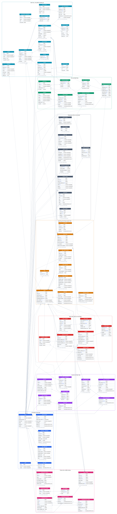

# Giải thích cơ sở dữ liệu NOVA và sơ đồ quan hệ

## 1. Phạm vi và nguồn dữ liệu

Lược đồ được đọc trực tiếp từ PostgreSQL trên Neon, schema `shop`, tại **07/11/2026 20:53 (UTC+7)** bằng giao dịch `READ ONLY`.
Tài liệu chỉ chứa metadata: tên bảng/cột, kiểu, khóa, CHECK, index, trigger, view và chữ ký hàm; không xuất người dùng, đơn hàng, mật khẩu, token hoặc giá trị cấu hình đang lưu.

| Thành phần | Số lượng |
| --- | ---: |
| Bảng | 66 |
| Cột | 495 |
| Khóa ngoại | 108 |
| View | 12 |
| Hàm/thủ tục | 17 |
| Chỉ mục, gồm cả chỉ mục phục vụ PK/UNIQUE | 212 |
| Trigger do ứng dụng khai báo | 15 |

## 2. Mở tài liệu và sơ đồ

- [Sơ đồ tương tác mở trong trình duyệt](csdl/SO-DO-CSDL.html): chọn nhóm, kéo và phóng to/thu nhỏ; không cần internet.
- [Sơ đồ SVG tổng thể](csdl/ERD-TOAN-BO.svg).
- [Trang tổng hợp các sơ đồ](csdl/SO-DO-CSDL.md).
- [Từ điển đủ 66 bảng và 495 cột](csdl/TU-DIEN-DU-LIEU.md).
- [Metadata gốc dùng để sinh tài liệu](csdl/SCHEMA-NEON.json).

## 3. Các nhóm dữ liệu

| Nhóm | Bảng chính trong nhóm |
| --- | --- |
| Tài khoản và xác thực | `auth_sessions`, `roles`, `user_addresses`, `user_roles`, `users`, `verification_challenges` |
| Danh mục, sản phẩm và đánh giá | `brands`, `categories`, `data_sources`, `favorites`, `home_banners`, `price_observations`, `product_images`, `product_specifications`, `product_variants`, `products`, `review_images`, `reviews`, `specification_definitions` |
| Kho và nhập hàng | `inventory_balances`, `inventory_movements`, `inventory_reservations`, `stock_receipt_items`, `stock_receipts`, `suppliers`, `warehouses` |
| Giỏ hàng, đơn hàng và giao nhận | `cart_items`, `carts`, `order_addresses`, `order_discounts`, `order_items`, `order_status_history`, `orders`, `shipment_events`, `shipments` |
| Thanh toán, đổi trả và hoàn tiền | `payment_attempts`, `payment_events`, `payment_methods`, `refund_items`, `refunds`, `return_items`, `return_requests` |
| Voucher và Flash Sale | `flash_campaigns`, `flash_reservations`, `flash_slot_items`, `flash_slots`, `flash_subscriptions`, `voucher_redemptions`, `voucher_scopes`, `vouchers` |
| Thành viên và điểm thưởng | `membership_accounts`, `membership_benefits`, `membership_policies`, `membership_tier_history`, `membership_tiers`, `points_ledger`, `tier_benefits` |
| Thông báo, hỗ trợ và vận hành | `audit_logs`, `device_tokens`, `notification_preferences`, `notifications`, `outbox_events`, `search_history`, `store_settings`, `support_messages`, `support_tickets` |

## 4. Chức năng từng bảng

| Bảng | Chức năng |
| --- | --- |
| `shop.audit_logs` | Nhật ký thao tác: người thực hiện, đối tượng, dữ liệu trước/sau và địa chỉ IP. |
| `shop.auth_sessions` | Phiên xác thực: lưu hash token, thiết bị, hạn dùng và thời điểm thu hồi. |
| `shop.brands` | Thương hiệu sản phẩm với mã, tên, logo và trạng thái hoạt động. |
| `shop.cart_items` | SKU và số lượng trong giỏ; dòng giỏ được xóa theo giỏ theo ràng buộc đang khai báo. |
| `shop.carts` | Giỏ hiện tại gắn với một người dùng. |
| `shop.categories` | Cây danh mục tự tham chiếu qua parent_id; có ảnh và thứ tự hiển thị. |
| `shop.data_sources` | Nguồn tham khảo/công bố dữ liệu sản phẩm hoặc giá. |
| `shop.device_tokens` | Token thiết bị dùng gửi thông báo, nền tảng và trạng thái hoạt động. |
| `shop.favorites` | Các cặp người dùng/sản phẩm đã đánh dấu yêu thích. |
| `shop.flash_campaigns` | Chương trình Flash Sale tổng, người tạo và trạng thái. |
| `shop.flash_reservations` | Giữ quota Flash Sale cho món đơn hàng trước khi hoàn tất/hết hạn. |
| `shop.flash_slot_items` | SKU tham gia khung Flash Sale, giá sale, quota và lượng giữ/đã bán. |
| `shop.flash_slots` | Khung thời gian thuộc một chương trình Flash Sale. |
| `shop.flash_subscriptions` | Người dùng đăng ký nhận nhắc cho một mục Flash Sale. |
| `shop.home_banners` | Banner Trang chủ với URL ảnh và sản phẩm được mở khi chạm. |
| `shop.inventory_balances` | Số tồn on_hand và số đang giữ reserved cho từng cặp kho/SKU. |
| `shop.inventory_movements` | Nhật ký tăng/giảm kho, liên kết phiếu nhập hoặc món đơn hàng và khóa chống ghi lặp. |
| `shop.inventory_reservations` | Giữ số lượng theo món đơn hàng, SKU và kho trong thời gian xử lý đơn. |
| `shop.membership_accounts` | Hạng hiện tại của mỗi người dùng và mốc đánh giá hạng. |
| `shop.membership_benefits` | Danh mục quyền lợi thành viên. |
| `shop.membership_policies` | Chính sách quy đổi tiền thành điểm, thời gian xét hạng/hết hạn điểm và hiệu lực. |
| `shop.membership_tier_history` | Nhật ký thay hạng từ hạng cũ sang hạng mới cùng chi tiêu đủ điều kiện. |
| `shop.membership_tiers` | Các hạng thành viên, thứ tự hạng, ngưỡng chi tiêu và hệ số ưu đãi. |
| `shop.notification_preferences` | Tùy chọn nhận cập nhật đơn, nhắc Flash Sale và marketing của người dùng. |
| `shop.notifications` | Thông báo trong ứng dụng: tiêu đề/nội dung, dữ liệu điều hướng, thời điểm đọc và khóa chống trùng. |
| `shop.order_addresses` | Bản chụp địa chỉ giao hàng của đơn để thay đổi sổ địa chỉ không đổi lịch sử đơn. |
| `shop.order_discounts` | Các khoản giảm giá áp dụng cho một đơn và mã giảm giá được chụp lại. |
| `shop.order_items` | Các món trong đơn với bản chụp SKU/tên/ảnh/giá và số lượng tại lúc đặt. |
| `shop.order_status_history` | Lịch sử chuyển trạng thái đơn, người thay đổi, lý do và thời điểm. |
| `shop.orders` | Đơn hàng: khách, kho, phương thức thanh toán, tổng tiền, trạng thái và các mốc xử lý. |
| `shop.outbox_events` | Sự kiện chờ xử lý theo mẫu outbox: payload, thời điểm sẵn sàng, số lần thử và lỗi gần nhất. |
| `shop.payment_attempts` | Mỗi lần tạo thanh toán cho đơn, gồm mã nhà cung cấp, số tiền, QR/URL và hạn dùng. |
| `shop.payment_events` | Sự kiện từ nhà cung cấp thanh toán, payload và tình trạng đã xử lý. |
| `shop.payment_methods` | Danh mục phương thức thanh toán và cờ thanh toán trực tuyến. |
| `shop.points_ledger` | Sổ cái cộng/trừ điểm; gắn đơn/hoàn tiền, ngày hết hạn và khóa chống ghi trùng. |
| `shop.price_observations` | Lịch sử ghi nhận giá của SKU từ nguồn, kèm URL và thời điểm quan sát. |
| `shop.product_images` | URL ảnh sản phẩm, tùy chọn gắn SKU, alt text và thứ tự hiển thị; không lưu byte ảnh. |
| `shop.product_specifications` | Giá trị thông số của từng sản phẩm; nối sản phẩm với loại thông số. |
| `shop.product_variants` | SKU bán hàng: màu, RAM, bộ nhớ, giá hiện tại/niêm yết và trạng thái. |
| `shop.products` | Thông tin chung sản phẩm, thương hiệu, danh mục, mô tả và cờ nổi bật. |
| `shop.refund_items` | Các món được hoàn, số tiền/số lượng và cờ nhập lại kho. |
| `shop.refunds` | Yêu cầu/kết quả hoàn tiền của đơn, lần thanh toán và yêu cầu đổi/trả liên quan. |
| `shop.return_items` | Các món, số lượng và số tiền yêu cầu thuộc một yêu cầu đổi/trả. |
| `shop.return_requests` | Yêu cầu đổi/trả, loại xử lý, lý do, bằng chứng và bản chụp chính sách. |
| `shop.review_images` | URL các ảnh đính kèm một đánh giá. |
| `shop.reviews` | Đánh giá sản phẩm, số sao và tham chiếu món đã mua để kiểm tra quyền đánh giá. |
| `shop.roles` | Danh mục vai trò để phân quyền tài khoản. |
| `shop.search_history` | Từ khóa và thời điểm tìm kiếm của từng tài khoản. |
| `shop.shipment_events` | Các sự kiện trạng thái giao nhận của một vận đơn. |
| `shop.shipments` | Thông tin vận chuyển của đơn: đơn vị giao, mã vận đơn và các mốc giao hàng. |
| `shop.specification_definitions` | Danh mục các loại thông số kỹ thuật và đơn vị. |
| `shop.stock_receipt_items` | Các dòng SKU, số lượng và giá vốn của phiếu nhập. |
| `shop.stock_receipts` | Phiếu nhập kho: kho nhận, nhà cung cấp, người ghi nhận và trạng thái ghi sổ. |
| `shop.store_settings` | Cấu hình cửa hàng dạng JSON; bản tài liệu chỉ đọc cấu trúc cột, không xuất giá trị cấu hình đang lưu. |
| `shop.suppliers` | Thông tin nhà cung cấp phục vụ phiếu nhập. |
| `shop.support_messages` | Tin nhắn trong phiếu hỗ trợ với người gửi và các URL đính kèm. |
| `shop.support_tickets` | Phiếu hỗ trợ của khách, đơn liên quan, phân loại, trạng thái và quản trị viên phụ trách. |
| `shop.tier_benefits` | Bảng nối hạng thành viên với quyền lợi và nội dung cụ thể. |
| `shop.user_addresses` | Sổ địa chỉ của người dùng, gồm người nhận, vị trí và cờ địa chỉ mặc định. |
| `shop.user_roles` | Bảng nối nhiều-nhiều giữa tài khoản và vai trò; khóa chính ghép ngăn gán trùng cùng vai trò. |
| `shop.users` | Tài khoản và hồ sơ: email, hash mật khẩu, họ tên, avatar, trạng thái, xác minh email và ngày sinh. |
| `shop.verification_challenges` | Challenge OTP theo mục đích; lưu hash/HMAC mã, số lần thử, hạn dùng và trạng thái tiêu thụ. |
| `shop.voucher_redemptions` | Các lượt giữ/sử dụng voucher gắn với người dùng và đơn. |
| `shop.voucher_scopes` | Phạm vi áp dụng voucher theo sản phẩm, danh mục hoặc hạng thành viên. |
| `shop.vouchers` | Định nghĩa mã giảm giá, công thức/giới hạn tiền, thời hạn và hạn mức sử dụng. |
| `shop.warehouses` | Danh mục kho hàng và vị trí kho. |

## 5. Các quan hệ cần hiểu

- `users` và `roles` nối qua `user_roles`, thể hiện một tài khoản có thể mang nhiều vai trò.
- `categories.parent_id` tham chiếu chính `categories.id`, tạo cây danh mục; sản phẩm gắn thương hiệu và danh mục.
- Một `products` có các `product_variants` để bán theo SKU và `product_images` để hiển thị bộ ảnh.
- Giá, tồn và món hàng được kiểm soát ở cấp SKU; `inventory_balances` dùng khóa ghép kho/SKU.
- `orders` có `order_items`, địa chỉ chụp trong `order_addresses` và các dòng lịch sử trạng thái.
- `payment_attempts` ghi từng lần tạo thanh toán; `payment_events` nhận sự kiện nhà cung cấp và có dữ liệu chống lặp.
- `return_requests`/`return_items` mô tả yêu cầu đổi/trả; `refunds`/`refund_items` mô tả phần hoàn tiền.
- Voucher, Flash Sale và điểm thưởng dùng các bảng ghi nhận/giữ chỗ riêng để theo dõi vòng đời nghiệp vụ.
- Một số FK là khóa ghép, ví dụ ảnh/SKU cùng sản phẩm hoặc món cùng đơn. Chúng kiểm tra sự nhất quán của cả bộ cột, không chỉ từng ID riêng.

## 6. Những quy tắc lưu trữ quan trọng

- Tiền dùng các cột nguyên hậu tố `_vnd`; không dùng số thực để lưu tiền VND.
- Mốc thời gian dùng các kiểu SQL được ghi ở từ điển, phần lớn là timestamp with time zone; thời gian hiển thị cần theo múi giờ người dùng.
- `password_hash`, token hash/HMAC và challenge tách khỏi dữ liệu hồ sơ được trả cho Android.
- Neon lưu **URL ảnh**; Cloudinary lưu **byte ảnh**. `product_images.url` và `users.avatar_url` liên kết hai hệ thống.
- Các trường `_snapshot` giữ giá trị tại thời điểm giao dịch, giúp thay đổi sản phẩm/địa chỉ về sau không đổi lịch sử đơn.
- `idempotency_key`, `dedup_key` và các unique constraint ngăn ghi lặp theo nghiệp vụ tương ứng.
- CHECK ràng buộc trạng thái/số lượng/tiền; index hỗ trợ truy vấn và ràng buộc, không phải bảng dữ liệu độc lập.
- `on_hand - reserved` là ý nghĩa lượng có thể bán của một cặp kho/SKU; cách tổng hợp được thể hiện trong view/SQL của đồ án.

## 7. FE, BE, Neon và Cloudinary phối hợp

FE Android gọi HTTPS API của BE. Controller nhận request, service kiểm tra nghiệp vụ/phiên/giao dịch, repository chạy SQL trên Neon.
Với ảnh, BE kiểm tra và tải Cloudinary trước khi lưu URL hợp lệ vào Neon. FE nhận URL từ JSON để hiển thị.
Gói FE và BE được tách về thư mục; liên kết HTTP vẫn giữ nguyên, không cần đặt hai thư mục cạnh nhau.

## 8. Phân biệt lược đồ thật và SQL nằm trong gói BE

Tài liệu này mô tả toàn bộ **66 bảng hiện có trên Neon**. Backend GK chỉ sử dụng một phần của lược đồ cho các endpoint đang giữ.
File `database/017_home_featured.sql` trong gói chỉ là migration đánh dấu sản phẩm nổi bật; không phải script khởi tạo đủ 66 bảng.
Các file ERD, JSON và tài liệu không tự chạy SQL, không triển khai backend và không thay đổi dữ liệu.

## 9. Cách đọc ký hiệu ERD

`PK` là khóa chính, `FK` là khóa ngoại, `UK` là unique một cột. `?` trong SVG chỉ cột được cho NULL.
`||` là đúng một, `o|` là không hoặc một, `o{` là không hoặc nhiều. Phía bảng cha có thể tùy chọn nếu FK của bản ghi con cho NULL.
Nét liền chỉ FK tham gia khóa chính của bảng con; nét đứt là FK còn lại. Nét này không thay cho chính sách ON DELETE.
SVG tổng thể chỉ hiện các cột chính để dễ nhìn; Mermaid và từ điển giữ đủ các cột. Bảng xám trong sơ đồ nhóm là bảng được tham chiếu ngoài nhóm.
Các cạnh được lấy từ 108 FK thật; không tự thêm quan hệ chỉ vì hai bảng có tên cột giống nhau.
