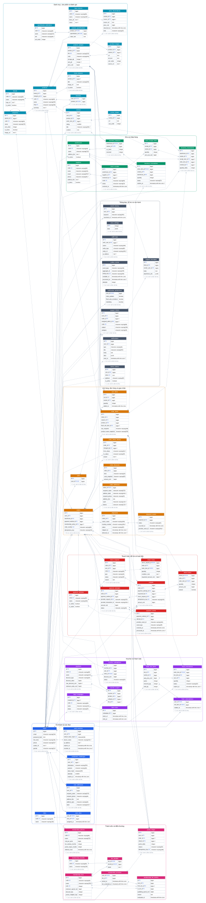
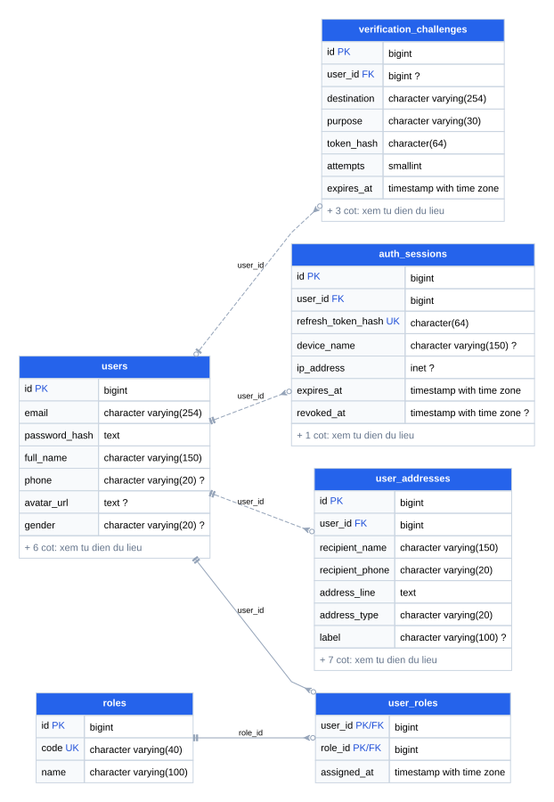
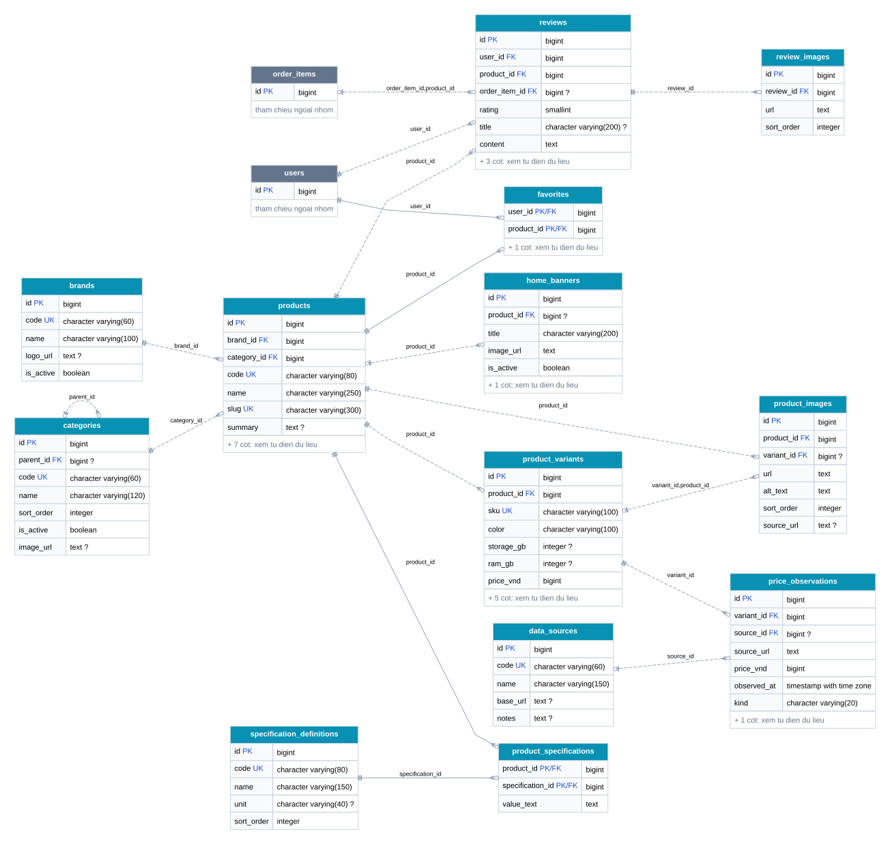
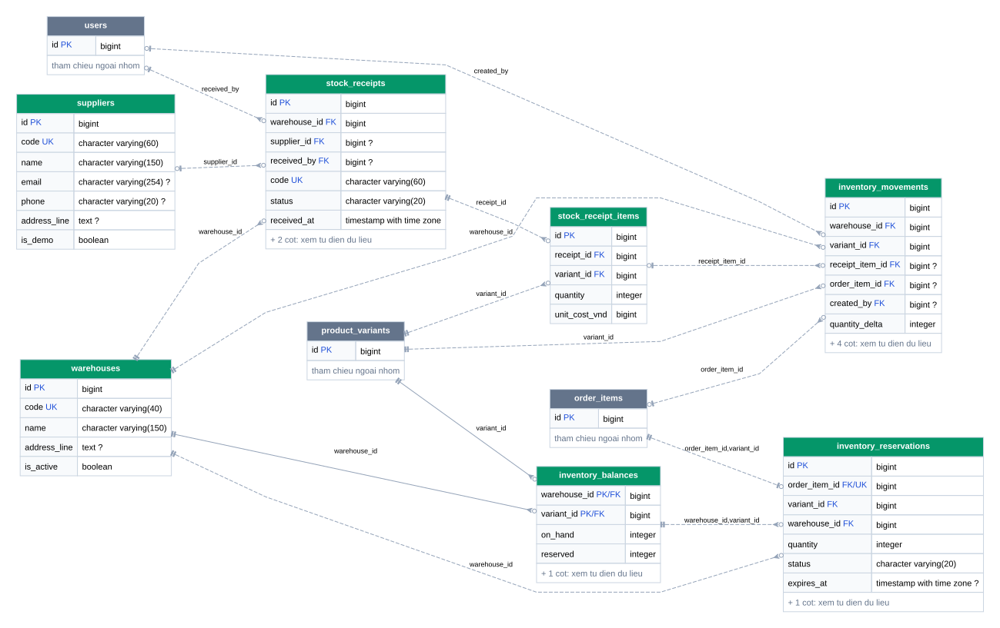
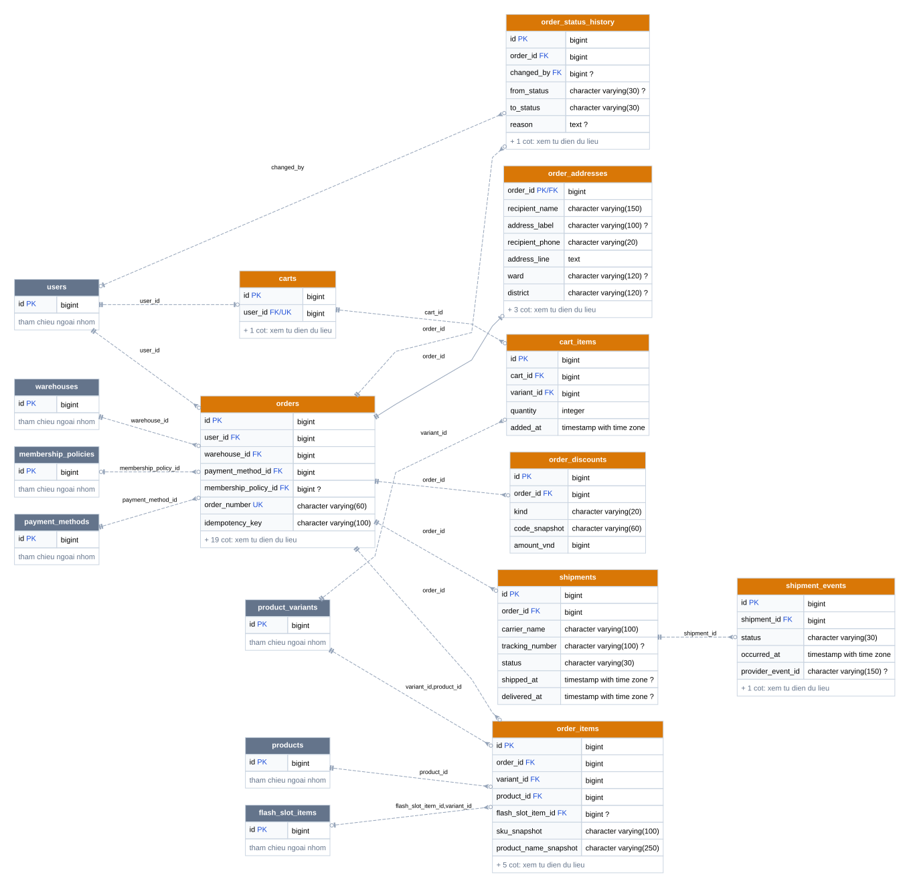
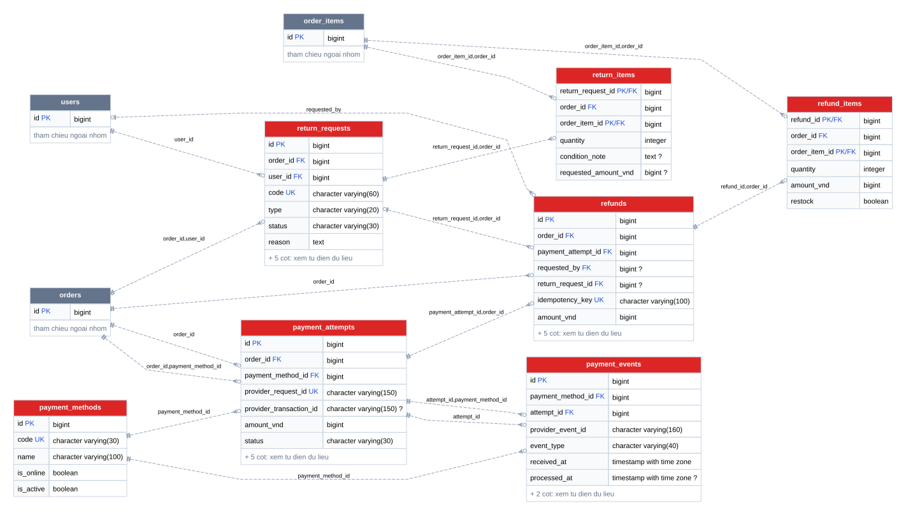
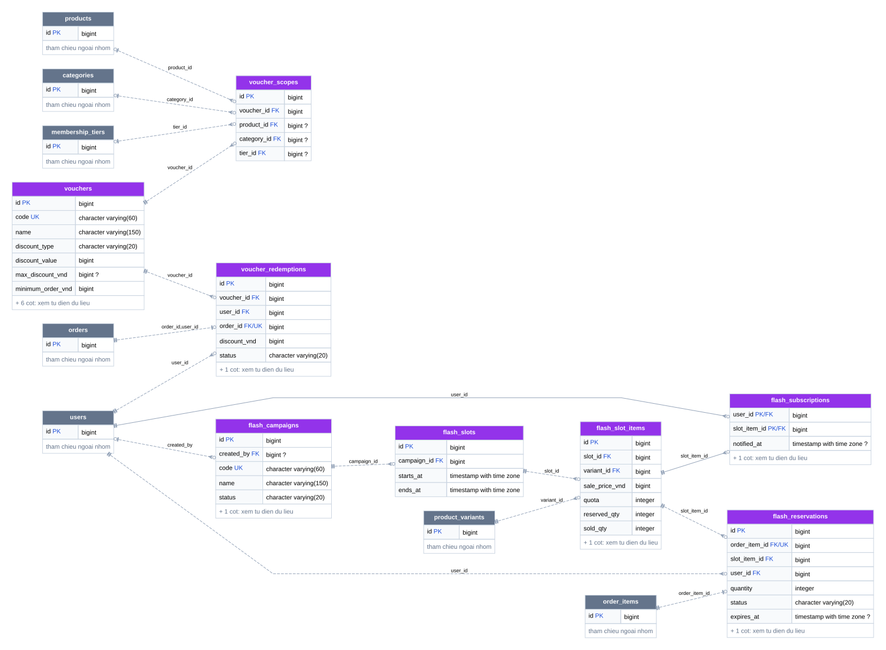
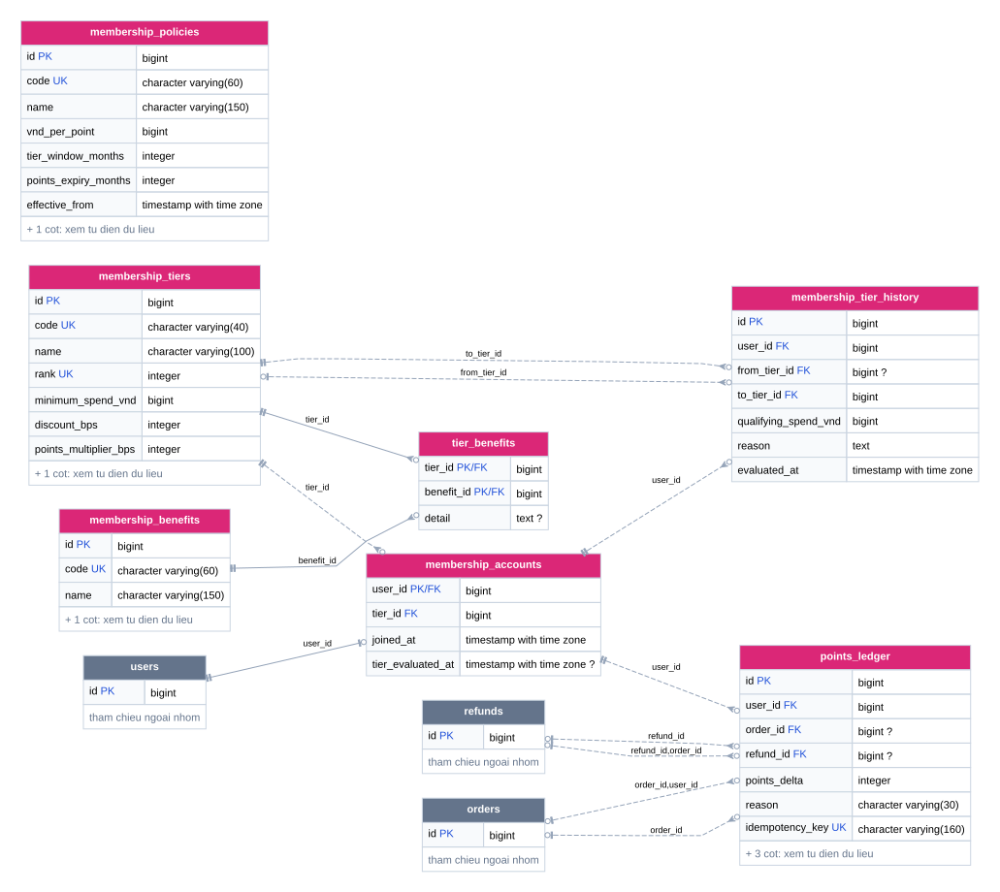
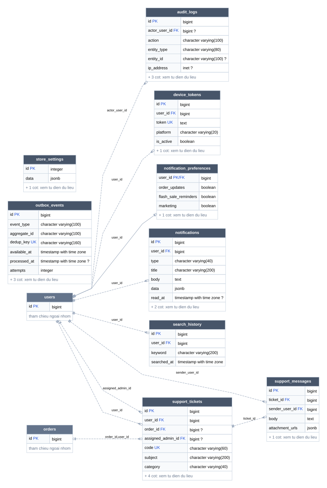

# Sơ đồ CSDL NOVA

[Mở bản tương tác trong trình duyệt](SO-DO-CSDL.html) · [Giải thích CSDL](../GIAI-THICH-CSDL.md) · [Từ điển cột/khóa](TU-DIEN-DU-LIEU.md)

Sơ đồ được sinh từ metadata Neon. SVG giữ các cột chính; các file Mermaid kèm theo giữ đủ cột. Bảng xám là tham chiếu ngoài nhóm.

## Toàn bộ 66 bảng

66 bảng trong phạm vi, 108 FK; số bảng hiển thị có thể tăng do có bảng tham chiếu ngoài nhóm.

[Mở SVG](ERD-TOAN-BO.svg) · [Mã Mermaid](ERD-TOAN-BO.mmd)

## Tài khoản và xác thực

6 bảng trong phạm vi, 5 FK; số bảng hiển thị có thể tăng do có bảng tham chiếu ngoài nhóm.

[Mở SVG](ERD-TAI-KHOAN.svg) · [Mã Mermaid](ERD-TAI-KHOAN.mmd)

## Danh mục, sản phẩm và đánh giá

13 bảng trong phạm vi, 17 FK; số bảng hiển thị có thể tăng do có bảng tham chiếu ngoài nhóm.

[Mở SVG](ERD-SAN-PHAM.svg) · [Mã Mermaid](ERD-SAN-PHAM.mmd)

## Kho và nhập hàng

7 bảng trong phạm vi, 15 FK; số bảng hiển thị có thể tăng do có bảng tham chiếu ngoài nhóm.

[Mở SVG](ERD-KHO-HANG.svg) · [Mã Mermaid](ERD-KHO-HANG.mmd)

## Giỏ hàng, đơn hàng và giao nhận

9 bảng trong phạm vi, 17 FK; số bảng hiển thị có thể tăng do có bảng tham chiếu ngoài nhóm.

[Mở SVG](ERD-DON-HANG.svg) · [Mã Mermaid](ERD-DON-HANG.mmd)

## Thanh toán, đổi trả và hoàn tiền

7 bảng trong phạm vi, 16 FK; số bảng hiển thị có thể tăng do có bảng tham chiếu ngoài nhóm.

[Mở SVG](ERD-THANH-TOAN-DOI-TRA.svg) · [Mã Mermaid](ERD-THANH-TOAN-DOI-TRA.mmd)

## Voucher và Flash Sale

8 bảng trong phạm vi, 16 FK; số bảng hiển thị có thể tăng do có bảng tham chiếu ngoài nhóm.

[Mở SVG](ERD-KHUYEN-MAI.svg) · [Mã Mermaid](ERD-KHUYEN-MAI.mmd)

## Thành viên và điểm thưởng

7 bảng trong phạm vi, 12 FK; số bảng hiển thị có thể tăng do có bảng tham chiếu ngoài nhóm.

[Mở SVG](ERD-THANH-VIEN.svg) · [Mã Mermaid](ERD-THANH-VIEN.mmd)

## Thông báo, hỗ trợ và vận hành

9 bảng trong phạm vi, 10 FK; số bảng hiển thị có thể tăng do có bảng tham chiếu ngoài nhóm.

[Mở SVG](ERD-HE-THONG-HO-TRO.svg) · [Mã Mermaid](ERD-HE-THONG-HO-TRO.mmd)
